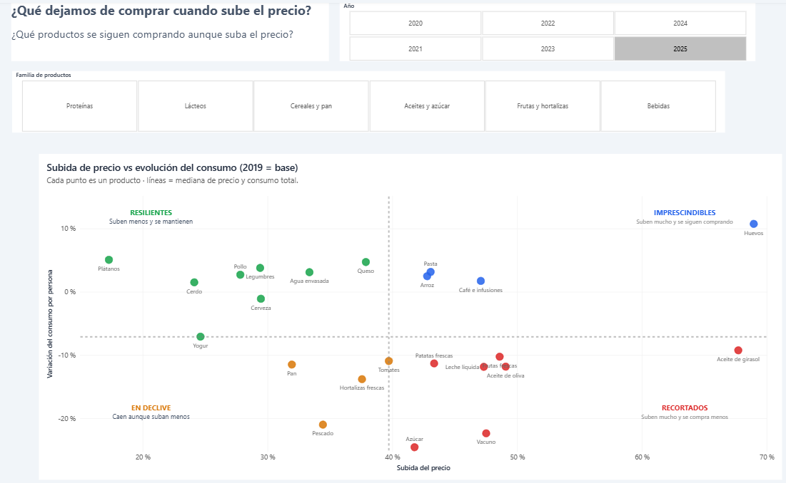
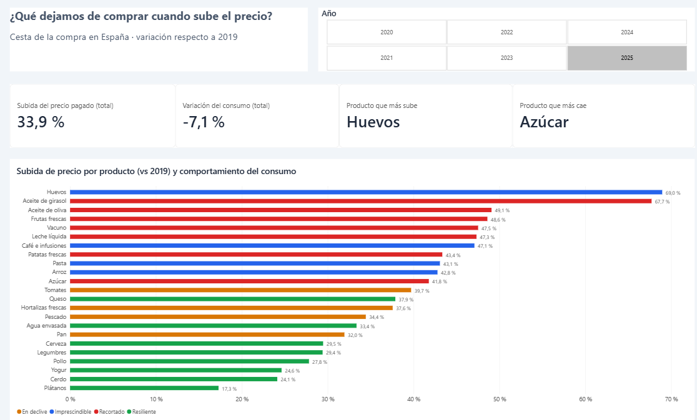
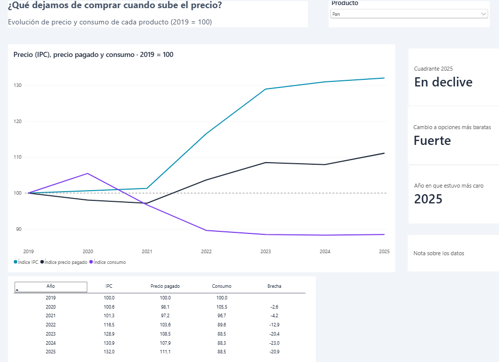
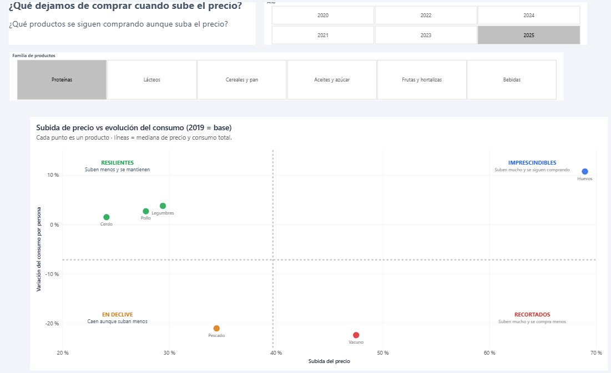

# ¿Qué dejamos de comprar cuando sube el precio?

Análisis de la inflación de la cesta de la compra en España (2019–2025) cruzando el **IPC por subclases (INE)** con el **Panel de Consumo Alimentario en Hogares (MAPA)**.



## Pregunta de negocio

¿Qué productos de la cesta son **imprescindibles** (se siguen comprando aunque suban), cuáles se **recortan** y en cuáles los hogares **buscan alternativas más baratas**?

## Principales hallazgos (2025 vs 2019)

1. **Los hogares pagan más por comprar menos.** El precio medio pagado por los alimentos sube un **34%**, el consumo por persona cae un **7%** y el gasto por persona aumenta un **24%**.
2. **Se cambia de proteína.** El **vacuno** (−22% de consumo) y el **pescado** (−21%) se hunden, mientras que **huevos** (+11%), **legumbres** (+4%), **pollo** (+3%) y **cerdo** (+2%) aguantan o crecen. Los huevos son el producto que más sube (+69%) y, aun así, se compra más: es la proteína barata que sustituye a la carne.
3. **El trading down es masivo en productos básicos.** En el **pan** y el **agua envasada**, el precio pagado sube unos **20 puntos menos** que el IPC: los hogares se pasan a marca blanca, formatos grandes o supermercados de descuento. También pasa en **legumbres** (−16) y **café** (−11).
4. **Hay productos que se recortan sin alternativa.** El **azúcar** (−25% de consumo), la **leche**, la **fruta fresca** y las **patatas** (−10/−12%) bajan sin que se vea un cambio fuerte a opciones más baratas.
5. **La demanda vuelve cuando el precio baja.** El **aceite de oliva** llegó a costar **2,5 veces** lo de 2019 en 2024 y su consumo cayó un **27%**. En 2025, con el precio en retroceso (+49%), el consumo se recuperó hasta el **−12%**. El recorte era coyuntural, no un abandono.

## El dashboard (Power BI)

| Resumen | Detalle por producto |
|---|---|
|  |  |

**Matriz filtrada por proteínas:** la sustitución de la carne de vacuno y el pescado por huevos, pollo, cerdo y legumbres.



El informe tiene 3 páginas: **Resumen** (KPIs y ranking de subidas), **Matriz** (precio × consumo, filtrable por año y familia) y **Detalle** (evolución de cada producto). Archivo: [`powerbi/cesta_compra_ipc.pbix`](powerbi/cesta_compra_ipc.pbix).

## Datos

| Fuente | Qué aporta | Detalle |
|---|---|---|
| **IPC por subclases (INE)** | Cuánto sube el precio de cada producto | Medias anuales 2019–2025, ECOICOP ver. 2 |
| **Panel de Consumo Alimentario en Hogares (MAPA)** | Cuánto compran los hogares y cuánto pagan | Total España, 24 productos, 2019–2025 |

## Cómo leer los resultados

Todos los indicadores son **índices con 2019 = 100**: para saber cuánto ha cambiado algo, se le resta 100.
*Ejemplo:* 168,96 = **+69%** respecto a 2019 · 88,50 = **−11,5%**.

### Las columnas de `cesta_final.csv`

| Columna | Qué mide | Cómo se lee |
|---|---|---|
| `ajuste` | Calidad del cruce entre el producto del MAPA y su subclase del IPC | *exacto* > *aproximado* > *agregado* |
| `idx_ipc` | Subida del precio "puro": mismo producto, misma calidad | 168,96 → el precio ha subido un 69% |
| `idx_precio_pagado` | Subida de lo que **realmente pagan** los hogares por kg o litro | 164,61 → pagan un 65% más por kilo |
| `idx_consumo_pc` | Kilos o litros que compra cada persona en casa | 110,74 → compran un 11% más |
| `brecha_trading_down` | `idx_precio_pagado − idx_ipc` | **Negativa** → los hogares se pasan a opciones más baratas |

### Dos medidas de precio: la clave del análisis

- El **IPC** responde a: *¿cuánto ha subido este producto?*
- El **precio medio pagado** responde a: *¿cuánto más está gastando la gente por kilo?*

Si el precio pagado sube **menos** que el IPC, los hogares están compensando la subida: cambian a **marca blanca**, a **formatos más baratos** o a **supermercados de descuento**. A esa diferencia la llamamos **brecha de trading down**.

### Ejemplo: el pan (2025 vs 2019)

| idx_ipc | idx_precio_pagado | idx_consumo_pc | brecha |
|---|---|---|---|
| 131,95 | 111,07 | 88,50 | −20,88 |

- El IPC indica que la **misma barra cuesta un 32% más**.
- Pero el **kilo de pan que compran los hogares solo ha subido un 11%**.
- La diferencia (**−21 puntos**) indica que la gente **cambia de pan**: pan de supermercado en vez de panadería, marca blanca, barras más baratas.
- Además, **compra un 11,5% menos** de pan.

➡️ Ante la subida, los hogares **buscan alternativas más baratas y, además, recortan**.

### Dos comportamientos distintos

- **Huevos** (IPC +69% · consumo **+11%** · brecha −4): apenas se buscan alternativas y **se compra más**. Es un producto **imprescindible**: proteína barata que sustituye a la carne.
- **Azúcar** (IPC +42% · consumo **−25%** · brecha −4): no hay alternativa más barata, así que **se recorta directamente**.

### ⚠️ Cuándo no fiarse de la brecha

- En los productos con ajuste **agregado**, el IPC mide una categoría más amplia. Por ejemplo, el **vacuno** se compara con *toda la carne fresca*: su brecha positiva (+8) no significa que se pague de más, sino que **el vacuno subió más que el pollo o el cerdo**. En esos casos se usan solo el precio pagado y el consumo.
- **Total alimentación** se compara con el **Índice general** del IPC (no existe un total de alimentos equivalente), así que su brecha se deja vacía.

## Clasificación de productos: la matriz precio × consumo

Cada producto se sitúa en uno de cuatro cuadrantes según dos preguntas (2025 vs 2019):

1. **¿Su precio ha subido más que la mediana de la cesta?** (en 2025, la mediana es +39,7%)
2. **¿Su consumo ha aguantado mejor que el de la alimentación en general?** (en 2025, el total cae un −7,1%)

|                                   | Precio sube **menos** que la mediana | Precio sube **más** que la mediana |
|-----------------------------------|--------------------------------------|------------------------------------|
| **Consumo aguanta** (≥ total)     | 🟢 **Resiliente**: sube poco y se sigue comprando | 🔵 **Imprescindible**: sube mucho y aun así se sigue comprando |
| **Consumo cae más** que el total  | 🟡 **En declive**: cae aunque no suba tanto (cambio de hábitos) | 🔴 **Recortado**: sube mucho y la gente compra menos |

**¿Por qué comparar el consumo con el total y no con cero?** Porque tras el COVID los hogares comen menos en casa y el consumo de casi todo cae. Comparando con el total se descuenta ese efecto general y se ve qué productos se comportan **mejor o peor que la media**.

**Precio que se usa:** el IPC cuando el cruce es *exacto* o *aproximado*; el precio pagado (MAPA) cuando es *agregado*, porque ahí el IPC mide una categoría más amplia.

### Resultado 2025

| Cuadrante | Productos |
|---|---|
| 🔵 Imprescindible | Huevos, café, pasta, arroz |
| 🔴 Recortado | Aceite de oliva, aceite de girasol, vacuno, azúcar, leche, frutas frescas, patatas |
| 🟢 Resiliente | Pollo, cerdo, legumbres, queso*, agua envasada, cerveza, plátanos, yogur* |
| 🟡 En declive | Pan, pescado, hortalizas frescas, tomates* |

\* **Caso frontera**: está a menos de 2 puntos de algún umbral, así que su cuadrante es poco robusto (columna `caso_frontera`).

**Lectura rápida:** la proteína barata (huevos, pollo, cerdo, legumbres) aguanta o crece, mientras que el vacuno y el pescado caen con fuerza. Es la **sustitución dentro de la proteína**.

### Otras columnas de `kpis_cuadrantes.csv`

| Columna | Qué indica |
|---|---|
| `consumo_relativo_pct` | Puntos por encima (+) o por debajo (−) de la evolución del consumo total |
| `sensibilidad` | Variación del consumo ÷ variación del precio. Descriptiva, **no** es una elasticidad causal |
| `trading_down` | Fuerte (brecha ≤ −10), Moderado (≤ −5) o Bajo. *No evaluable* en cruces agregados |
| `anio_pico_precio` | Año en que el producto estuvo más caro (p. ej. aceite de oliva, 2024) |

## Propuesta de valor: qué haría un supermercado con estos datos

| Grupo | Productos | Comportamiento | Acción propuesta |
|---|---|---|---|
| 🔵 **Imprescindibles** | Huevos, pasta, arroz, café | La demanda aguanta subidas fuertes | **Asegurar disponibilidad** (cero roturas de stock) y usarlos como **productos gancho** en promociones, porque atraen tráfico a la tienda. No necesitan descuentos agresivos para venderse. |
| Trading down fuerte | Pan, agua, legumbres, café | El cliente busca la opción barata | **Reforzar la marca propia y los formatos ahorro** (barra de precio bajo, garrafas de agua, legumbre a granel o en formato grande). El cliente se va a ir a lo barato; mejor que lo encuentre en nuestra tienda. |
| 🔴 **Recortados** | Aceite de oliva y girasol, vacuno, azúcar, leche, fruta, patatas | Sensibles al precio: se compra menos cuando suben | **Formatos pequeños** (aceite de 500 ml, bandejas de vacuno de menor peso) para mantener un precio por unidad asumible, y **promociones selectivas**. En el aceite, **comunicar rápido las bajadas de precio**: la demanda vuelve en cuanto baja. |
| Sustitución de proteína | Vacuno y pescado → pollo, cerdo, huevos y legumbres | El cliente cambia de proteína, no deja de comer proteína | **Redistribuir espacio en el lineal y promociones** hacia la proteína barata, y combinar productos con **recetas o packs** (p. ej. "menú semanal por menos de X €"). En pescado, dar visibilidad a congelados y conservas como alternativa más económica. |
| 🟡 **En declive** | Pan, pescado, hortalizas frescas | Caen más de lo que explica el precio: cambio de hábitos | El precio no es la palanca. Apostar por **conveniencia** (hortaliza lavada y cortada, pescado limpio y listo para cocinar) y por **comunicación de salud** para recuperar el consumo. |

**Seguimiento:** el dashboard se puede actualizar cada año con los nuevos datos del INE y del MAPA para comprobar si los productos cambian de cuadrante (como el aceite de oliva entre 2022 y 2025) y ajustar la estrategia a tiempo.

## Limitaciones

- La relación entre precio y consumo es **descriptiva, no causal**: también influyen la renta, los hábitos post-COVID o el consumo fuera del hogar.
- El panel del MAPA mide solo el **consumo en el hogar** (no incluye hostelería).
- La clasificación ECOICOP ver. 2 del IPC es menos detallada que el MAPA: en 8 productos el cruce es **agregado** (p. ej. pollo, cerdo y vacuno comparten el IPC de "carne fresca").
- No hay datos abiertos de **marca blanca** por producto: el trading down se aproxima con la brecha entre IPC y precio pagado.

Todas las decisiones metodológicas están en [`docs/NOTAS_README.md`](docs/NOTAS_README.md).

## Estructura

```
├── data/
│   ├── raw/
│   │   ├── ine/              ← IPC por subclases (CSV original del INE)
│   │   └── mapa/             ← Excel anuales del MAPA, renombrados mapa_hogares_<año>_c<censo>.xlsx
│   ├── mapeo_mapa_ipc.csv    ← cruce producto MAPA ↔ subclase(s) IPC
│   └── processed/            ← tablas limpias (cesta_final.csv es la que usa Power BI)
├── notebooks/                ← scripts de limpieza y análisis
├── powerbi/                  ← dashboard (.pbix)
└── docs/                     ← notas metodológicas y capturas
```

## Cómo ejecutarlo

```bash
python -m venv .venv
.venv\Scripts\activate
pip install -r requirements.txt
python notebooks/01_limpieza_mapa.py
python notebooks/02_ipc_y_union.py
python notebooks/03_kpis_cuadrantes.py
```
